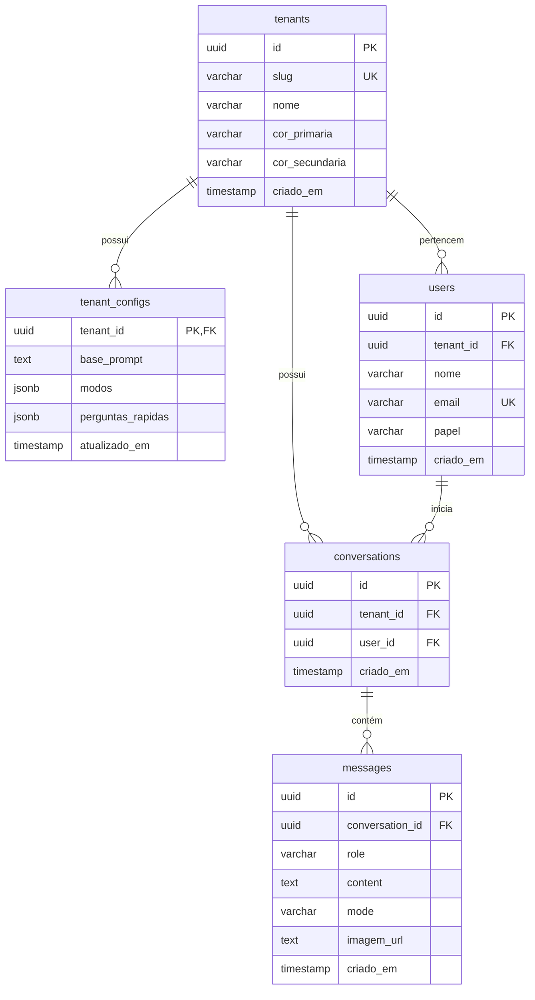

# 🗄️ Modelagem de Dados Relacional (Multi-Tenant)

Este documento descreve o modelo de dados relacional (PostgreSQL) para a futura migração da aplicação multi-tenant do estado temporário (`st.session_state`) para um banco de dados persistente.

---

## 📐 Visão Geral & Diagrama ERD

---

## 📋 Detalhamento das Tabelas

### 1. `tenants`
Armazena as informações institucionais e a identidade visual de cada organização/cliente atendido pela plataforma.

| Coluna | Tipo de Dado | Restrições | Descrição |
|---|---|---|---|
| `id` | `UUID` | `PRIMARY KEY`, Default `gen_random_uuid()` | Identificador único do tenant. |
| `slug` | `VARCHAR(64)` | `UNIQUE`, `NOT NULL` | Identificador amigável usado na URL (ex: `senai_labfashion` via `?tenant=...`). |
| `nome` | `VARCHAR(255)` | `NOT NULL` | Nome de exibição do tenant (ex: `"SENAI LabFashion IA"`). |
| `cor_primaria` | `VARCHAR(7)` | `NOT NULL` | Código Hexadecimal da cor primária (ex: `"#0047AB"`). |
| `cor_secundaria` | `VARCHAR(7)` | `NOT NULL` | Código Hexadecimal da cor secundária (ex: `"#F47B20"`). |
| `criado_em` | `TIMESTAMP WITH TIME ZONE` | Default `CURRENT_TIMESTAMP` | Timestamp de criação do registro do tenant. |

---

### 2. `tenant_configs`
Armazena os prompts de sistema, especialidades/modos do assistente e perguntas rápidas configuradas para cada tenant.

| Coluna | Tipo de Dado | Restrições | Descrição |
|---|---|---|---|
| `tenant_id` | `UUID` | `PRIMARY KEY`, `FOREIGN KEY` -> `tenants(id)` ON DELETE CASCADE | Chave primária e estrangeira vinculada ao tenant. |
| `base_prompt` | `TEXT` | `NOT NULL` | Prompt base de sistema com regras éticas, escopo e diretrizes gerais. |
| `modos` | `JSONB` | `NOT NULL` | Objeto JSON com os modos do assistente, seus prompts específicos e ferramentas (`tools`). |
| `perguntas_rapidas` | `JSONB` | `NOT NULL` | Objeto JSON mapeando a lista de perguntas rápidas recomendadas por modo. |
| `atualizado_em` | `TIMESTAMP WITH TIME ZONE` | Default `CURRENT_TIMESTAMP` | Data/hora da última alteração na configuração do tenant. |

> [!NOTE]
> **Justificativa do modelo JSONB para `modos` e `perguntas_rapidas`:**
> Manter `modos` e `perguntas_rapidas` em colunas do tipo `JSONB` no PostgreSQL permite que novas especialidades e ferramentas de IA sejam criadas ou atualizadas dinamicamente sem a necessidade de efetuar migrações de estrutura (DDL) no banco de dados.

---

### 3. `users`
Registra os usuários cadastrados na plataforma e seu vínculo institucional com o tenant.

| Coluna | Tipo de Dado | Restrições | Descrição |
|---|---|---|---|
| `id` | `UUID` | `PRIMARY KEY`, Default `gen_random_uuid()` | Identificador único do usuário. |
| `tenant_id` | `UUID` | `FOREIGN KEY` -> `tenants(id)` ON DELETE CASCADE, `NOT NULL` | Tenant ao qual o usuário pertence. |
| `nome` | `VARCHAR(255)` | `NOT NULL` | Nome completo do usuário. |
| `email` | `VARCHAR(255)` | `UNIQUE`, `NOT NULL` | Endereço de e-mail de acesso. |
| `papel` | `VARCHAR(32)` | `NOT NULL`, Default `'user'` | Função do usuário (ex: `'admin'`, `'instructor'`, `'user'`). |
| `criado_em` | `TIMESTAMP WITH TIME ZONE` | Default `CURRENT_TIMESTAMP` | Timestamp de cadastro do usuário. |

---

### 4. `conversations`
Representa uma sessão/thread de atendimento ou consulta aberta por um usuário sob um determinado tenant.

| Coluna | Tipo de Dado | Restrições | Descrição |
|---|---|---|---|
| `id` | `UUID` | `PRIMARY KEY`, Default `gen_random_uuid()` | Identificador único da conversa/sessão. |
| `tenant_id` | `UUID` | `FOREIGN KEY` -> `tenants(id)` ON DELETE CASCADE, `NOT NULL` | Tenant isolado da conversa. |
| `user_id` | `UUID` | `FOREIGN KEY` -> `users(id)` ON DELETE SET NULL | Usuário que criou a conversa. |
| `criado_em` | `TIMESTAMP WITH TIME ZONE` | Default `CURRENT_TIMESTAMP` | Data e hora de abertura da conversa. |

---

### 5. `messages`
Armazena o histórico completo das mensagens enviadas e recebidas em cada conversa.

| Coluna | Tipo de Dado | Restrições | Descrição |
|---|---|---|---|
| `id` | `UUID` | `PRIMARY KEY`, Default `gen_random_uuid()` | Identificador único da mensagem. |
| `conversation_id` | `UUID` | `FOREIGN KEY` -> `conversations(id)` ON DELETE CASCADE, `NOT NULL` | Conversa à qual a mensagem pertence. |
| `role` | `VARCHAR(32)` | `NOT NULL` | Papel da mensagem no modelo OpenAPI/Groq (`'user'`, `'assistant'`, `'system'`, `'tool'`). |
| `content` | `TEXT` | `NOT NULL` | Conteúdo textual da mensagem. |
| `mode` | `VARCHAR(64)` | NULL | Modo do assistente ativo durante a geração (ex: `'Gerador de Croqui'`). |
| `imagem_url` | `TEXT` | NULL | URL da imagem gerada por ferramenta (croqui), quando aplicável. |
| `criado_em` | `TIMESTAMP WITH TIME ZONE` | Default `CURRENT_TIMESTAMP` | Timestamp de envio ou geração da mensagem. |

---

## 🔒 Segurança e Isolamento Multi-Tenant

1. **Row Level Security (RLS)**: As tabelas `users`, `conversations` e `messages` devem possuir políticas de RLS ativas para garantir que consultas SQL por um tenant nunca retornem registros de outros clientes.
2. **Índices Recomendados**:
   - `CREATE INDEX idx_tenants_slug ON tenants(slug);`
   - `CREATE INDEX idx_conversations_tenant_user ON conversations(tenant_id, user_id);`
   - `CREATE INDEX idx_messages_conversation ON messages(conversation_id, criado_em);`
